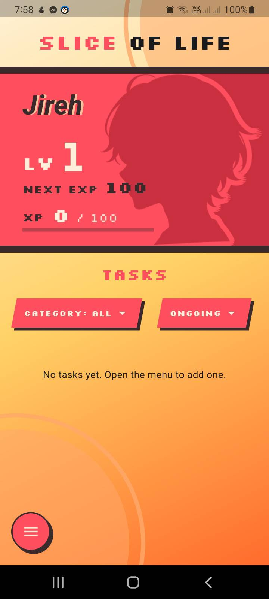
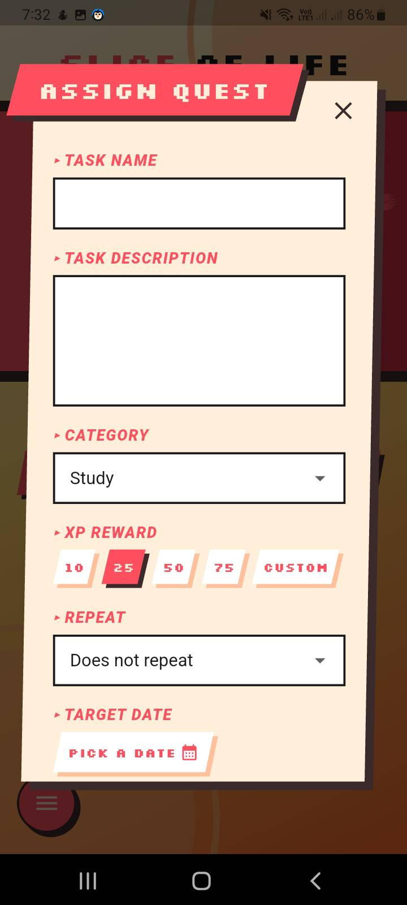
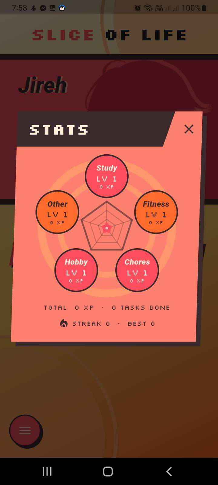
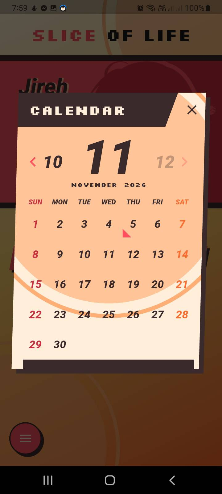
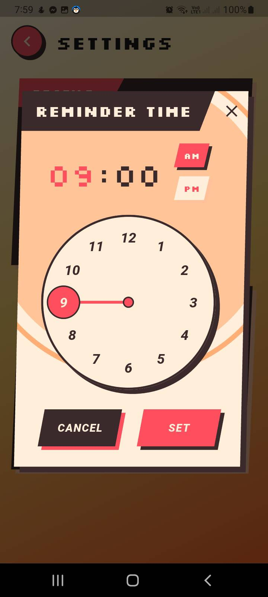

<h1 align="center">Slice of Life</h1>
<p align="center"><b>Make every slice of life count.</b></p>
<p align="center">
  A gamified to-do app: finish real-life tasks, earn XP, and level up your own persona.<br>
  Built with Flutter for Android, with a Persona 3 Reload inspired look.
</p>

<!--
  Add screenshots to docs/screenshots/ and uncomment this block (see "Screenshots" below):

-->

## Why Slice of Life?

Most to-do lists tell you _what_ to do, but they never make you feel like you are getting anywhere.
Slice of Life turns everyday responsibilities (studying, chores, working out, new hobbies) into quests.
Every quest you finish earns XP, XP raises your level, and the persona you picked grows with you,
so progress is something you can actually see.

It is made for students who want to build better habits, especially anyone who loves RPGs and anime
and would be more motivated if real-world wins counted as progress in a game.

## Features

**Quests**

- Create tasks with a name, description, category and XP reward (10, 25, 50, 75 or your own amount).
- Add an optional target date from a calendar.
- Organize by category (Study, Fitness, Chores, Hobby, Other) and switch between _Ongoing_, _Completed_ and _All_.

**Progress**

- Earn XP for every quest, with a satisfying "+XP" pop, haptic feedback and an animated XP bar.
- Level up with a full-screen level-up popup. Level N needs N x 100 XP to reach the next level.
- Pick your persona from nine silhouettes (male, female or ambiguous) with a Stardew-style selector.

**Habits**

- Recurring quests: every day or on specific weekdays. They reset on their own, so you never recreate them.
- Streaks: finish a recurring quest on each scheduled day to keep your flame alive.
- Reminders: a daily check-in plus a notification on the target date of any unfinished quest, at a time you choose.

**Look back**

- Activity calendar: every day you finished at least one quest gets a stamp. Tap a day to see what you did.
- Stats: a pentagon chart across your five categories grows as you do more in each, with a level per category,
  your total XP and your current and best streak.

**Made to feel like a game**

- Slanted panels and pixel font (Silkscreen).
- Animated popups, sliding menus and a dock menu.
- Everything is stored on your phone. No account and no internet needed.

## How it works

| Thing            | Rule                                                                                                                     |
| ---------------- | ------------------------------------------------------------------------------------------------------------------------ |
| XP and levels    | Completing a quest adds its XP. Level N to N+1 costs N x 100 XP.                                                         |
| One-time quests  | Once completed they are locked: no un-ticking, editing or deleting.                                                      |
| Recurring quests | Done for the day once ticked, back to ongoing on the next scheduled day. The XP reward cannot be changed after creation. |
| Streaks          | +1 each scheduled day you finish it. Miss a scheduled day and it resets to 0.                                            |
| Calendar         | Dates come from your phone's clock. A star-stamp appears when at least one quest was completed that day.                 |
| Reminders        | Off by default. Turn them on in Settings; Android asks for notification permission the first time.                       |

## Screenshots

<p align="center">    </p>

## Get or try the app

**Android:** download the latest `.apk` from the [Releases](../../releases) page, open it on your phone
and allow installs from unknown sources if asked. (Releases are published by the author; if there is no release yet,
build it yourself below.)

## Built with

Flutter and Dart, SQLite (`sqflite`) for quests and history, `shared_preferences` for small settings,
`flutter_local_notifications` with `timezone` for reminders, and custom painters for the stats chart,
clock picker and silhouettes.

## Project layout

```
lib/
  main.dart            app entry point and theme
  core/                palette + pixel font, slanted shapes, popup transition
  models/              task, history entry, XP -> level math
  data/                SQLite database
  services/            reminder notifications
  widgets/             slanted buttons/chips, calendar parts, XP badge
  character/           persona art + picker
  popups/              stats, calendar, date/time pickers, level-up, name, option menu
  screens/             home, task editor, settings
assets/                fonts, persona silhouettes, app icon source
```

## Roadmap

Ideas that fit the app and are not built yet:

- Archive or clear old completed quests
- Streak milestone celebrations
- Backup and restore of your data

## About this project

Slice of Life is a student project, an MVP (Minimum Viable Product) built for the course _BSCS 2103 Application Development & Emerging
Technologies_. The idea, requirements document and design direction are by **Michal Jireh de la Cruz**; the app was
built by him with the help of AI tools, as the course asked.

The visual style is inspired by _Persona 3 Reload_. This is a fan-inspired, non-commercial project. It is not
affiliated with or endorsed by Atlus or SEGA, and it uses no assets from the games. The pixel font is
[Silkscreen](https://fonts.google.com/specimen/Silkscreen) by Jason Kottke.

## License

Released under the [MIT License](LICENSE).
